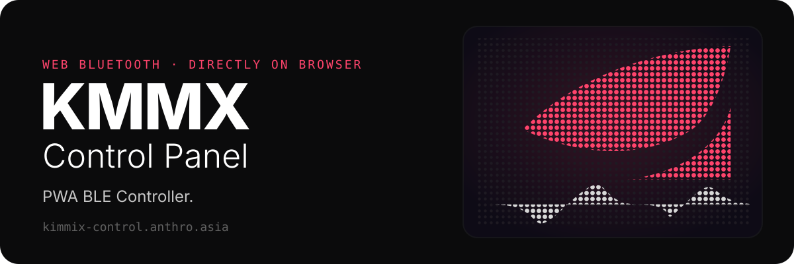

<p align="center">
  
</p>

<p align="center">
  <a href="https://kimmix-control.anthro.asia"><b>Open the live app</b></a>
  ·
  <a href="BLE_INTERFACE.md">BLE protocol</a>
  ·
  <a href="https://github.com/Kimmix/KMMX-Fursuit">KMMX-Fursuit firmware</a>
</p>

KMMX Control Panel is a Progressive Web App that talks to the
[KMMX-Fursuit](https://github.com/Kimmix/KMMX-Fursuit) over Bluetooth Low Energy.
Open it in the browser, tap to connect, and drive the suit's face. No app store, no install required.

## What it controls

- **Face** — 14 eye expressions and 10 mouth states
- **Lip sync** — audio-reactive visemes with live tuning
- **Display** — brightness, colors, and effects
- **Hardware** — horn LEDs, cheek panels, motion, glitch, and fan (V4 only)
- **Offline** — installable PWA with cached assets

## Quick start

Use the hosted app at **[kimmix-control.anthro.asia](https://kimmix-control.anthro.asia)**, or run it locally:

```bash
python -m http.server 8000
```

Open `http://localhost:8000`, tap the splash screen, and pick the **KMMX** device.

> [!NOTE]
> Web Bluetooth needs Chrome, Edge, or Opera and a secure context. `localhost` counts as secure for development.

## Lip sync tuning

The audio settings page offers fixed **Noise rejection** (1–1,000 RMS), independent
**Mouth size** (0.25–4×), and **Snappy / Natural / Smooth** response. Response presets adjust timing only.

**Calibrate Room** measures a fixed threshold after a quiet countdown. Stay silent for the full four
seconds; speaking during calibration can set the threshold too high. Cancel or failure keeps the
previous settings. Booping and disconnecting the browser do not erase calibration.

Settings apply live and last until the controller restarts. Reboot restores threshold 13, mouth
size 1×, and Natural response. Boops and BLE reconnects preserve current RAM settings. Previously
stored tuning is ignored; no viseme settings are saved to flash. The panel reads device settings on
reconnect and shows microphone and calibration failures.

<details>
<summary><b>Firmware compatibility</b></summary>

New tuning requires 10-byte settings v2 and status v3, with the matching updated panel.

| Panel | Firmware | Result |
| --- | --- | --- |
| New | New | Full tuning |
| New | Old / unsupported | Basic controls + update message |
| Old | New | Lip-sync on/off and basic controls; old tuning sliders unsupported |

Update both panel and firmware to use tuning. Refresh when the installed PWA shows an update
notice. No settings are migrated from the old RAM-only adaptive system.

</details>

## Development

```bash
node --test tests/*.test.cjs
```

Covers session settings, status decoding, and panel feedback (Node 24 or newer; no package install).

```text
KMMX-ControlPanel/
├── index.html · manifest.json · sw.js
├── src/
│   ├── config/     BLE UUIDs, expressions, mouth states
│   ├── core/       app, BLE, controls, navigation, viseme
│   ├── managers/
│   └── utils/
└── asset/          css, svg
```

BLE UUIDs live in `src/config/ble-config.js`. Byte layouts and compatibility are in
[BLE_INTERFACE.md](BLE_INTERFACE.md).

---

Copyright © 2023 Kimmix. Authorized use only.
